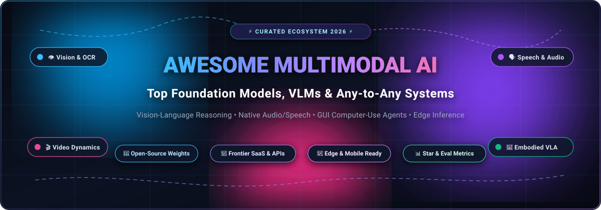

<div align="center">



# 🌟 Awesome Multimodal AI Models

### 🚀 A Curated Directory of Vision-Language Models (VLMs), Any-to-Any Foundation Models, GUI Agents & Robotics VLAs

<p align="center">
<a href="https://github.com/ishandutta2007/Awesome-Awesome-Awesome"></a><a href="https://discord.gg/jc4xtF58Ve"></a>
<a href="https://github.com/ishandutta2007/Awesome-Multimodal-AI-Models/stargazers"></a>
<a href="https://github.com/ishandutta2007/Awesome-Multimodal-AI-Models/network/members"></a>
<a href="https://github.com/ishandutta2007/Awesome-Multimodal-AI-Models/pulls"></a>
<a href="https://opensource.org/licenses/MIT"></a>
<a href="https://github.com/ishandutta2007"></a>
</p>

<p align="center">
  <b>Explore state-of-the-art Multimodal AI Systems across Vision, Text, Speech, Video, and Embodied Robotics.</b><br>
  Comparing proprietary frontier SaaS APIs against transparent, downloadable open-source weights.
</p>

</div>

---

## 📑 Table of Contents

- [📖 Introduction & Overview](#-introduction--overview)
- [📊 Sector Overview & Market Dynamics](#-sector-overview--market-dynamics)
- [🏢 SaaS & Frontier Enterprise Platforms](#-saas--frontier-enterprise-platforms)
- [🌐 Open-Source GitHub Projects (Ranked by Stars)](#-open-source-github-projects-ranked-by-stars)
- [🧭 Multimodal Architectural Paradigms](#-multimodal-architectural-paradigms)
- [❓ Frequently Asked Questions (FAQ)](#-frequently-asked-questions-faq)
- [🤝 How to Contribute](#-how-to-contribute)
- [📈 Star History](#-star-history)
- [⚖️ Disclaimer & License](#️-disclaimer--license)

---

## 📖 Introduction & Overview

**Multimodal Artificial Intelligence** represents the frontier of modern machine learning, transitioning models from isolated unimodal systems (text-only LLMs or standalone computer vision classifiers) into unified cognitive architectures that simultaneously perceive, reason across, and generate multiple modalities: **high-resolution images, long-form video, streaming audio, natural speech, tabular documents, GUI displays, and robotic physical actions**.

Whether you are an AI engineer building autonomous computer-use agents, deploying low-latency vision-language models on edge hardware (mobile/Raspberry Pi/smart cameras), or fine-tuning vision-language-action (VLA) models for robotic manipulation, this repository delivers an authoritative, production-tested index of tools, models, APIs, and benchmarks.

---

## 📊 Sector Overview & Market Dynamics

The global **Multimodal AI Market** was valued at approximately **$2.1 Billion in 2024** and is projected to surge past **$18.5 Billion to $32.0 Billion by 2030**, compounding at an aggressive **CAGR of ~34.5%**. This rapid acceleration is propelled by enterprise adoption of native multi-sensory workflows, document OCR intelligence, autonomous screen-parsing GUI agents, and real-time streaming conversational speech.

The market structure currently operates under a distinct **"barbell" concentration dynamic**:
- **Frontier API & Cloud Layer (Highly Concentrated / Oligopolistic):** Dominated by hyperscalers and frontier research labs (Microsoft/OpenAI, Alphabet/Google, and Anthropic). These providers command enormous computational clusters (100k+ GPU/TPU clusters), massive proprietary pre-training datasets, and integrated cloud distribution channels.
- **Open-Weights & Edge Deployment Layer (Moderately Fragmented & Rapidly Democratizing):** Open-source models—pioneered by Alibaba's Qwen team, OpenGVLab (InternVL), OpenBMB (MiniCPM-V), DeepSeek, and Hugging Face—are rapidly compressing the capability gap. Optimized small-footprint models (1B–8B parameters) enable organizations to achieve frontier-grade visual document reasoning and GUI control on consumer GPUs without API token costs or vendor lock-in.

---

## 🏢 SaaS & Frontier Enterprise Platforms

Frontier cloud providers offering hosted APIs, developer SDKs, and consumer workspaces for multimodal reasoning. Sorted descending by parent organization market capitalization and corporate valuation.

| 🏆 Product / Platform | 🏢 Parent Organization | 💰 Valuation / Market Cap | ⚡ Modalities Supported | 💳 Starting Paid Tier Pricing | 🎁 Free Tier Limits & Trial Quota |
|:---|:---|:---|:---|:---|:---|
| [**Microsoft Azure OpenAI & Copilot**](https://azure.microsoft.com/en-us/products/ai-services/openai-service) | Microsoft Corporation | **~$3.12 Trillion** *(Market Cap)* | Text, Vision, Speech, Document Parsing, Code, Video frames | **Copilot Pro:** $20.00/user/month<br>**Azure API (GPT-4o mini):** $0.150 / 1M input tokens, $0.600 / 1M output tokens<br>**Azure API (GPT-4o):** $2.50 / 1M input tokens, $10.00 / 1M output tokens | **Free Web Access:** Free web chat on Copilot with dynamic rate-limited GPT-4o vision access.<br>**Developer Trial:** Azure Free Account includes **$200 free credit** valid for 30 days plus 55+ services free for 12 months. |
| [**Google Gemini**](https://ai.google.dev/) | Alphabet Inc. (Google DeepMind) | **~$2.14 Trillion** *(Market Cap)* | Native Any-to-Any (Text, Image, 1hr+ Audio/Video, Code, Realtime Stream) | **Gemini Advanced:** $19.99/month *(Google One AI Premium)*<br>**Gemini 1.5 Flash API (&lt;128k context):** $0.075 / 1M input tokens, $0.300 / 1M output tokens<br>**Gemini 1.5 Pro API:** $1.25 / 1M input tokens, $5.00 / 1M output tokens | **Free App Access:** Gemini web and mobile apps free forever for standard reasoning.<br>**Google AI Studio API:** **Free-for-ever tier** providing **15 Requests Per Minute (RPM)**, **1,000,000 Tokens Per Minute (TPM)**, and **1,500 Requests Per Day (RPD)** with no expiration date. |
| [**OpenAI GPT-4o**](https://platform.openai.com/) | OpenAI | **~$157 Billion** *(Private Valuation)* | Text, High-Res Vision, Real-Time Audio Voice-to-Voice, Video Frames | **ChatGPT Plus:** $20.00/user/month<br>**GPT-4o mini API:** $0.150 / 1M input tokens, $0.600 / 1M output tokens ($0.075 cached input)<br>**GPT-4o API:** $2.50 / 1M input tokens, $10.00 / 1M output tokens ($1.25 cached input) | **Free Web Access:** ChatGPT Free tier includes dynamic **10–16 GPT-4o messages every 3 hours** with vision, falling back to GPT-4o mini.<br>**Developer Trial:** New developers receive **$5.00 in free API credits** valid for 90 days upon account phone verification. |
| [**Anthropic Claude 3.5**](https://www.anthropic.com/claude) | Anthropic PBC | **~$60 Billion** *(Private Valuation)* | Text, Vision, Document OCR, Chart/Diagram Extraction, Code Execution | **Claude Pro:** $20.00/user/month<br>**Claude 3.5 Haiku API:** $0.80 / 1M input tokens, $4.00 / 1M output tokens<br>**Claude 3.5 Sonnet API:** $3.00 / 1M input tokens, $15.00 / 1M output tokens | **Free Web Access:** Claude.ai web access includes **~30 to 50 messages every 5 hours** (dynamically adapted based on real-time server load).<br>**Developer Trial:** Anthropic Console API provides **$5.00 in free credit** upon initial SMS verification. |
| [**Mistral AI (Pixtral / Le Chat)**](https://mistral.ai/) | Mistral AI | **~$6.0 Billion** *(€5.8B Valuation)* | High-Resolution Vision, Multi-Image Context, Multilingual NLP, Document Analysis | **Le Chat Pro:** €14.90/month (~$16.00/month)<br>**Pixtral 12B API:** $0.150 / 1M input tokens, $0.150 / 1M output tokens<br>**Pixtral Large API:** $2.00 / 1M input tokens, $6.00 / 1M output tokens | **Free Web Access:** Completely free unlimited access to Pixtral 12B multimodal reasoning and web search via the Le Chat interface.<br>**Developer Trial:** La Plateforme API grants **€5.00 ($5.40) in free credits** valid for 30 days upon sign-up. |
| [**Twelve Labs**](https://www.twelvelabs.io/) | Twelve Labs Inc. | **~$250 Million** *($77M Venture Funded)* | Deep Video-to-Text, Temporal Natural Language Video Search, Zero-Shot Video QA | **Pay-As-You-Go Indexing:** $0.05 per minute of video ingested (~$3.00 per hour of video)<br>**Search Queries:** $0.01 per natural language video search call<br>**Pegasus Video Generation API:** $0.002 per generated token | **Free Developer Tier:** **10 hours (600 minutes) of total video indexing and search storage every month** free forever with no credit card required. |

---

## 🌐 Open-Source GitHub Projects (Ranked by Stars)

A comprehensive index of open-source multimodal models, vision-language architectures, evaluation frameworks, and robotics libraries. Each repository is equipped with an official social star badge linking directly to its stargazers page, sorted in **descending order by GitHub star count**.

### 1. 🤖 [LeRobot](https://github.com/huggingface/lerobot) [](https://github.com/huggingface/lerobot/stargazers)
- **Primary Domain:** Embodied AI & Robotics Vision-Language-Action (VLA)
- **License:** Apache 2.0
- **Key Highlights:** Hugging Face’s flagship open-source robotics library built in PyTorch. Provides end-to-end learning pipelines from human demonstrations, teleoperation, simulation-to-real robot transfer, and pretrained policy checkpoints for physical manipulation tasks.

### 2. ⚡ [MiniCPM-V](https://github.com/OpenBMB/MiniCPM-V) [](https://github.com/OpenBMB/MiniCPM-V/stargazers)
- **Primary Domain:** Ultra-Efficient Edge & Mobile Multimodal Reasoning (MiniCPM-V 4.5 / 2.6)
- **License:** Apache 2.0
- **Key Highlights:** Revolutionary 8B edge model family matching and surpassing much larger models (GPT-4o-latest, Qwen2.5-VL-72B) on multiple benchmarks. Utilizes a unified 3D-Resampler architecture achieving **96x visual token compression** (compressing 6 consecutive 448×448 frames into just 64 visual tokens). Features hybrid reinforcement learning saving 30% training costs.

### 3. 🖥️ [OmniParser](https://github.com/microsoft/OmniParser) [](https://github.com/microsoft/OmniParser/stargazers)
- **Primary Domain:** Vision-Based Screen Parsing for GUI Autonomous Agents
- **License:** MIT
- **Key Highlights:** Microsoft’s pure vision screen-parsing module that transforms raw UI screenshots into structured interactive bounding boxes and text semantics. Empowers multimodal models to navigate desktop OSs, web browsers, and smartphones without relying on HTML DOM trees.

### 4. 👁️ [LLaVA](https://github.com/haotian-liu/LLaVA) [](https://github.com/haotian-liu/LLaVA/stargazers)
- **Primary Domain:** Visual Instruction Tuning & Foundation Vision-Language Model
- **License:** Apache 2.0 / LLaVA Custom
- **Key Highlights:** The pioneering open-source Vision-Language framework that established the visual instruction tuning paradigm. Pairs a CLIP/SigLIP vision encoder with Vicuna/Llama backbones, forming the empirical foundation and baseline for subsequent open-weights VLM research.

### 5. 🇨🇳 [Qwen2.5-VL](https://github.com/QwenLM/Qwen2.5-VL) [](https://github.com/QwenLM/Qwen2.5-VL/stargazers)
- **Primary Domain:** Frontier Vision-Language Family (3B, 7B, 72B & MoE Variants)
- **License:** Apache 2.0
- **Key Highlights:** Alibaba Cloud's flagship open-weights multimodal model. Features dynamic-resolution Vision Transformer with Interleaved-MRoPE (Multimodal Rotary Position Embedding), native support for 128k+ token context windows, hours-long video understanding, pixel-accurate visual grounding, and computer-use agent capabilities.

### 6. 🎯 [Segment Anything 2 (SAM 2)](https://github.com/facebookresearch/segment-anything-2) [](https://github.com/facebookresearch/segment-anything-2/stargazers)
- **Primary Domain:** Promptable Visual & Video Segmentation
- **License:** Apache 2.0
- **Key Highlights:** Meta AI's unified foundation model for promptable visual segmentation across static images and real-time streaming videos. Incorporates a streaming memory attention architecture that propagates target entity masks across temporal video frames in real time.

### 7. 🎨 [Janus / Janus-Pro](https://github.com/deepseek-ai/Janus) [](https://github.com/deepseek-ai/Janus/stargazers)
- **Primary Domain:** Unified Multimodal Understanding & Visual Generation
- **License:** Apache 2.0
- **Key Highlights:** DeepSeek’s novel multimodal model architecture that decouples visual encoding pathways into separate processing streams for visual comprehension (SigLIP) and visual generation (vector-quantized image tokenizer). Eliminates feature conflict between understanding and image generation.

### 8. 🦾 [OpenPI (π₀ / Pi-Zero)](https://github.com/Physical-Intelligence/openpi) [](https://github.com/Physical-Intelligence/openpi/stargazers)
- **Primary Domain:** Physical Intelligence & Flow-Matching Robotics Policy
- **License:** Apache 2.0
- **Key Highlights:** Official open-source implementation and weights for physical robotics models by Physical Intelligence. Utilizes flow-matching continuous-action experts grafted onto discrete Vision-Language Models to perform complex dexterous tasks like folding laundry and box packing.

### 9. 🖱️ [UI-TARS](https://github.com/ByteDance/UI-TARS) [](https://github.com/ByteDance/UI-TARS/stargazers)
- **Primary Domain:** Native End-to-End GUI Agent for Computer Interaction
- **License:** Apache 2.0
- **Key Highlights:** ByteDance's multimodal GUI agent model that perceives operating system desktop, web, and mobile screen pixels to directly output keyboard keystrokes and mouse click coordinates without intermediary optical character recognition or DOM access.

### 10. 🔬 [LAVIS](https://github.com/salesforce/LAVIS) [](https://github.com/salesforce/LAVIS/stargazers)
- **Primary Domain:** Language-Vision Intelligence Library (BLIP, InstructBLIP, BLIP-2)
- **License:** BSD-3-Clause
- **Key Highlights:** Salesforce Research’s one-stop deep learning library for multimodal machine learning. Powers foundational architectures such as BLIP, BLIP-2 (Q-Former cross-attention connector), and InstructBLIP for multimodal text-image generation and retrieval.

### 11. 🚀 [Mistral-Inference (Pixtral)](https://github.com/mistralai/mistral-inference) [](https://github.com/mistralai/mistral-inference/stargazers)
- **Primary Domain:** Reference Inference Engine for Pixtral 12B & Pixtral Large
- **License:** Apache 2.0
- **Key Highlights:** Mistral AI’s official inference engine supporting Pixtral 12B, featuring a 400M parameter 2D RoPE Vision Transformer natively handling arbitrary image aspect ratios and arbitrary resolutions up to 1024×1024 without cropping or padding.

### 12. 🏆 [InternVL / InternVL3.5](https://github.com/OpenGVLab/InternVL) [](https://github.com/OpenGVLab/InternVL/stargazers)
- **Primary Domain:** Frontier Open-Source Multimodal Family (1B to 241B)
- **License:** Apache 2.0
- **Key Highlights:** Flagship multimodal family by OpenGVLab. Features InternVL3.5-241B-A28B scoring 77.7 on MMMU (the highest open-source score). Incorporates dynamic visual resolution routing (ViR), 92.9 on ScreenSpot-v2 GUI localization, embodied spatial navigation, and native SVG vector graphics generation.

### 13. 🌙 [Moondream](https://github.com/vikhyat/moondream) [](https://github.com/vikhyat/moondream/stargazers)
- **Primary Domain:** Ultra-Lightweight (1.8B) Edge Vision-Language Model
- **License:** Apache 2.0
- **Key Highlights:** Compact vision model designed from scratch to run anywhere—including browser environments via WebAssembly, Raspberry Pi, Apple Silicon, and edge IoT devices—with sub-second response times for visual QA and object detection.

### 14. 🇨🇳 [GLM-4 / GLM-4V](https://github.com/THUDM/GLM-4) [](https://github.com/THUDM/GLM-4/stargazers)
- **Primary Domain:** Open Bilingual & Multimodal Models (GLM-4V-9B)
- **License:** Apache 2.0
- **Key Highlights:** THUDM/Zhipu AI’s open-source multimodal backbone. Supports high-resolution 1120×1120 inputs, complex visual document reasoning, and multi-turn bilingual vision-language conversations.

### 15. 🧠 [CogVLM / CogVLM2](https://github.com/THUDM/CogVLM) [](https://github.com/THUDM/CogVLM/stargazers)
- **Primary Domain:** Visual Expert Language Model
- **License:** Apache 2.0
- **Key Highlights:** Deep visual-language fusion model that adds dedicated visual expert modules in attention layers and FFNs, eliminating the bottleneck of shallow projector adapters and enabling deep multimodal reasoning.

### 16. 📜 [Qwen-VL](https://github.com/QwenLM/Qwen-VL) [](https://github.com/QwenLM/Qwen-VL/stargazers)
- **Primary Domain:** Predecessor Multimodal Baseline Series
- **License:** Apache 2.0
- **Key Highlights:** The foundational multimodal version of the Qwen series that first introduced position-aware vision perception, multi-image input dialogues, and fine-grained bounding-box grounding.

### 17. 🔮 [DeepSeek-VL2](https://github.com/deepseek-ai/DeepSeek-VL2) [](https://github.com/deepseek-ai/DeepSeek-VL2/stargazers)
- **Primary Domain:** Mixture-of-Experts (MoE) Vision-Language Architecture
- **License:** DeepSeek License
- **Key Highlights:** DeepSeek’s advanced MoE VLM family (featuring Tiny, Small, and Standard variants). Employs dynamic high-resolution tile partitioning to process intricate charts, tables, and ultra-high-resolution documents with sparse activation efficiency.

### 18. 📏 [LMMS-Eval](https://github.com/EvolvingLMMs-Lab/LMMS-Eval) [](https://github.com/EvolvingLMMs-Lab/LMMS-Eval/stargazers)
- **Primary Domain:** Standardized Multimodal Evaluation & Benchmarking Suite
- **License:** Apache 2.0
- **Key Highlights:** The de facto community standard acceleration toolkit for Large Multimodal Model evaluation. Unifies 50+ benchmarks (MMMU, MathVista, VideoMME, HallusionBench, MME, RealWorldQA) with one-line command reproducibility.

### 19. 🗣️ [Qwen2.5-Omni](https://github.com/QwenLM/Qwen2.5-Omni) [](https://github.com/QwenLM/Qwen2.5-Omni/stargazers)
- **Primary Domain:** Unified Any-to-Any Text, Vision, Audio & Speech Generation
- **License:** Apache 2.0
- **Key Highlights:** End-to-end multimodal omni-model perceiving text, vision, and audio while generating low-latency streaming speech and text. Built on the Thinker-Talker dual-track architecture with Time-aligned Multimodal RoPE (TMRoPE) for synchronous timestamp grounding.

### 20. 📝 [InternLM-XComposer](https://github.com/internlm/InternLM-XComposer) [](https://github.com/internlm/InternLM-XComposer/stargazers)
- **Primary Domain:** Interleaved Free-Form Text-Image Composition & Synthesis
- **License:** Apache 2.0
- **Key Highlights:** Advanced vision-language model tailored for long-context multimodal reading and rich interleaved article composition with automatically situated relevant illustrations.

### 21. 💬 [Multimodal-GPT](https://github.com/open-mmlab/Multimodal-GPT) [](https://github.com/open-mmlab/Multimodal-GPT/stargazers)
- **Primary Domain:** Vision-Language Instruction Fine-Tuning
- **License:** Apache 2.0
- **Key Highlights:** OpenMMLab’s vision-language dialogue system fine-tuned on OpenFlamingo to follow detailed user visual instructions for conversational multi-turn QA.

### 22. 🦾 [MolmoAct2](https://github.com/allenai/molmoact2) [](https://github.com/allenai/molmoact2/stargazers)
- **Primary Domain:** Fully Open Vision-Language-Action (VLA) Model for Robotics
- **License:** Apache 2.0
- **Key Highlights:** Allen Institute for AI's (Ai2) open VLA model for real-world robotics. Built on the MolmoER backbone, featuring the OpenFAST action tokenizer and trained on 720 hours of teleoperated bimanual trajectories across five distinct robot embodiments.

---

## 🧭 Multimodal Architectural Paradigms

Understanding how modern Multimodal AI systems are constructed helps AI engineers choose the optimal tool for their stack:

```
┌────────────────────────────────────────────────────────────────────────┐
│                   MULTIMODAL ARCHITECTURE PARADIGMS                    │
└────────────────────────────────────────────────────────────────────────┘

  1. DUAL-STREAM PROJECTION (e.g., LLaVA, InternVL, MiniCPM-V)
     [Vision Encoder: SigLIP/CLIP] ──► [MLP / Perceiver Resampler] ──► [LLM Backbone]
     ↳ High throughput, modular training, lightweight adaptation.

  2. DEEP VISUAL EXPERT FUSION (e.g., CogVLM)
     [Visual Input] ─────────► [Dedicated Visual Attention Weights] ──┐
                                                                      ├──► Combined Output
     [Text Tokens]  ─────────► [Language Transformer Layers]        ──┘
     ↳ Eliminates project compression bottlenecks, enables deep cross-modal reasoning.

  3. UNIFIED ANY-TO-ANY AUDIO-VISUAL (e.g., Qwen2.5-Omni, GPT-4o)
     [Text / Image / Video / Audio] ──► [Unified Multi-Modal Decoder] ──► [Streaming Speech + Text]
     ↳ Sub-second conversational voice latency, synchronized time-aligned RoPE.

  4. EMBODIED VISION-LANGUAGE-ACTION (e.g., LeRobot, OpenPI, MolmoAct2)
     [Camera Frames + Goal Prompt] ──► [VLM Backbone] ──► [Continuous Action Flow Matching] ──► [Robot Actuators]
     ↳ Physical manipulation, teleoperation, spatial 3D reasoning.
```

---

## ❓ Frequently Asked Questions (FAQ)

<details>
<summary><b>1. What is the difference between a VLM and an Any-to-Any multimodal model?</b></summary>
A Vision-Language Model (VLM) typically processes image/document inputs alongside text to generate text outputs (e.g., describing a diagram or answering questions). An Any-to-Any model (such as Qwen2.5-Omni or GPT-4o) can ingest any combination of audio, video, images, and text, and directly synthesize audio speech tokens, images, and text in real time.
</details>

<details>
<summary><b>2. Which open-source model is best suited for resource-constrained edge devices?</b></summary>
<b>MiniCPM-V 4.5</b> and <b>Moondream</b> are the top recommendations. MiniCPM-V's 96x visual compression achieves state-of-the-art results on 8B parameter budgets with low RAM usage, while Moondream (1.8B) can run efficiently in web browsers via WebAssembly and on edge CPUs.
</details>

<details>
<summary><b>3. How do GUI agent models (like OmniParser and UI-TARS) work?</b></summary>
GUI agent models operate on raw visual screenshots rather than relying on brittle HTML accessibility trees. OmniParser detects actionable icons and text bounding boxes, allowing an LLM/VLM to calculate exact screen coordinates for automated mouse clicks and keystrokes.
</details>

---

## 🤝 How to Contribute

Contributions are warmly encouraged! Help keep this multimodal directory up to date:

1. **Fork the repository** on GitHub.
2. **Add or update an entry** in [README.md](file:///C:/Users/hp/Documents/Projects/Awesome-Multimodal-AI-Models/README.md) maintaining the star ranking order, pricing specificity, and link formats.
3. **Verify licensing & links** to ensure factual accuracy and avoid broken URLs.
4. **Submit a Pull Request** with a concise description of your additions.

Explore more curated developer lists at [Awesome-Awesome-Awesome](https://github.com/ishandutta2007/Awesome-Awesome-Awesome).

---

## 📈 Star History

[](https://star-history.dera.page/#ishandutta2007/Awesome-Multimodal-AI-Models&type=date&legend=top-left)

---

## ⚖️ Disclaimer & License

- This compilation is community-curated for research, benchmarking, and engineering evaluation.
- Benchmark scores and commercial pricing tiers are accurate as of early 2026 and subject to provider revision.
- Distributed under the [MIT License](https://opensource.org/licenses/MIT).
